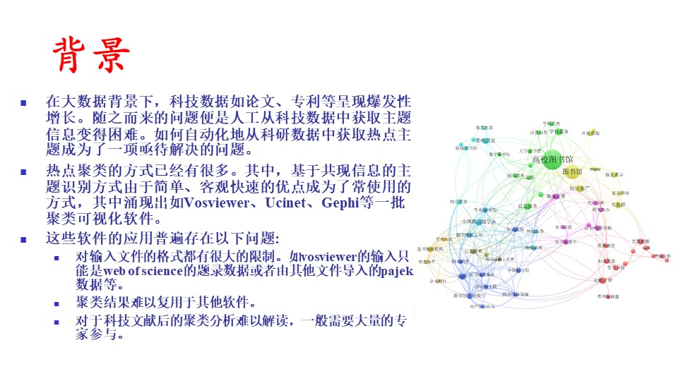
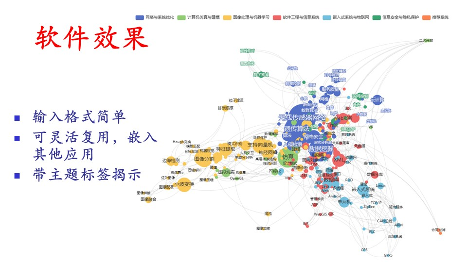
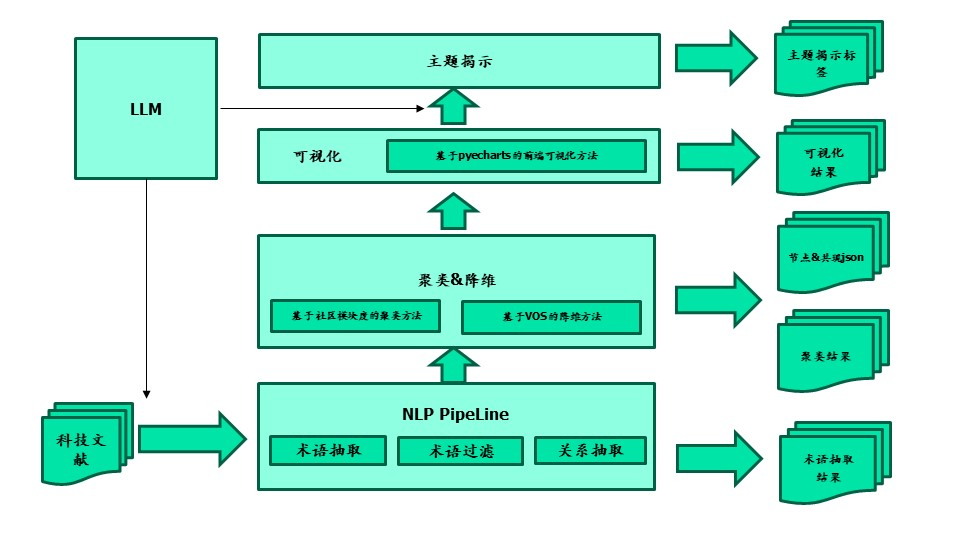

# Literature Topic Recognition V2

#### 项目介绍

基于 Streamlit 框架开发的文献主题识别系统，是对原 literature_topic_recognition 项目的重构版本。本项目提供了友好的 Web 界面，用于进行文献主题的自动识别与分类。

#### 更新日志
- 2024-12-18 增加了术语抽取部分，增加了进度条及错误处理，如果中间出错，将在输出文件位置放置空字符串，在程序运行结束后将错误的输入行号和输入信息也提供下载。
- 2024-12-18 增加了主题揭示部分，增加了获取标签结果之后的下载功能，可以将揭示标签结果下载为txt文件。
- 2024-12-23 增加了.env文件，用户配置可以使用.env文件，不需要在代码或者前台中每次配置。

#### 背景


#### 软件效果


#### 方法路线



#### 技术架构

- 前端框架：Streamlit
- 后端语言：Python
- 主要功能：文献主题识别、文本分类

#### 安装步骤

1. 克隆项目到本地
```bash
   git clone https://gitee.com/liyan24/literature_topic_recognization_v2.git
   cd literature-topic-recognition-v2

```

2. 安装依赖(python3.12)
```bash
pip install -r requirements.txt
```

或者：

```bash
pip install streamlit
pip install streamlit-echarts
pip install langchain
pip install langchain_openai
pip install networkx
pip install scikit-learn
```

建议使用国内镜像源安装，以提高安装速度。如：

```bash
pip install -i https://pypi.tuna.tsinghua.edu.cn/simple/ -r requirements.txt
```

以及
```bash
pip install streamlit -i https://pypi.tuna.tsinghua.edu.cn/simple/
pip install streamlit-echarts -i https://pypi.tuna.tsinghua.edu.cn/simple/
pip install langchain -i https://pypi.tuna.tsinghua.edu.cn/simple/
pip install langchain_openai -i https://pypi.tuna.tsinghua.edu.cn/simple/
pip install networkx -i https://pypi.tuna.tsinghua.edu.cn/simple/
pip install scikit-learn -i https://pypi.tuna.tsinghua.edu.cn/simple/

```


3. 运行项目
```bash
streamlit run app.py  
```

<<<<<<< HEAD

4. 在浏览器中访问 `http://localhost:8501`

#### 主要功能

- 文献主题自动识别
- 批量文献处理
- 主题分类可视化
- 结果导出功能

#### 项目结构
literature-topic-recognition-v2/
├── app.py # 主程序入口
├── requirements.txt # 项目依赖
├── models/ # 模型文件
├── utils/ # 工具函数
├── image/ # 图片文件
└── data/ # 数据文件


=======
4. 在浏览器中访问 `http://localhost:8501`（初次运行streamlit，需要填写邮箱）
    (1) 第一步输入的样例文件位于data\test.csv，需要配置相关大模型进行术语抽取（基于prompt，会消耗较多token），直接使用其他关键词列表可以跳过此步骤。
    (2) 第二步输入的样例文件位于data\keywords.txt。输出文件有cluster.txt及graph_data.json
    (3) 第三步输入的样例文件位于data\cluster.txt，需要配置相关大模型进行标签揭示，定义标签之后可以上传步骤二中的graph_data.json，生成标签更改后的可视化图。
